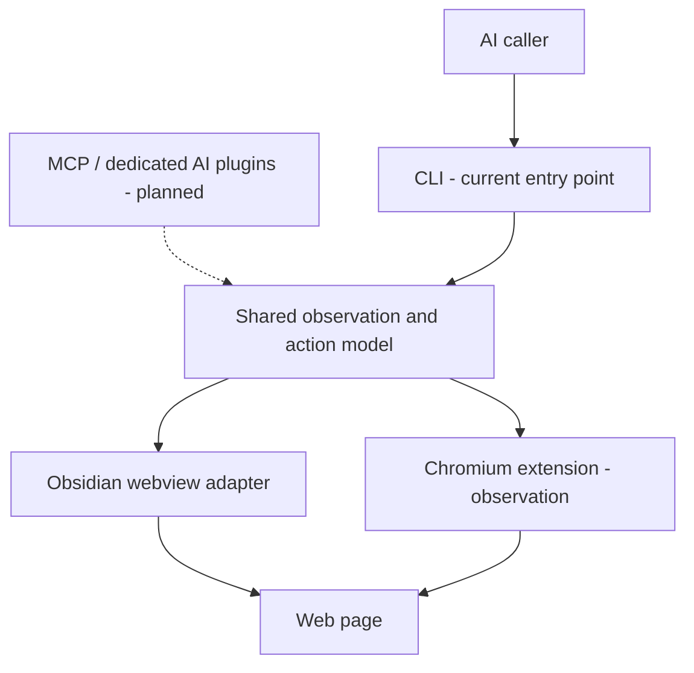

# Single Web Use (SWU)

**A browser interaction framework that helps AI inspect a page, act on a supported target and check the result.**

[한국어](README.ko.md) · [Author](https://github.com/juho-kim-dev)

Web pages change between observation and action. A target can move, the page can navigate, or a request can be cancelled before an input is sent. SWU separates page observation, target validation, input delivery and outcome checks so these conditions remain visible to the caller.

I develop SWU with AI assistance. The work covers browser adapters, a shared observation/action model, a CLI interface, state checks and verification of selected browser workflows.

## Current implementation scope

| Component | Current scope |
| --- | --- |
| Obsidian webview adapter | Main development environment for page observation and supported interactions |
| CLI | Current entry point for discovering commands, reading page state and requesting supported actions |
| Shared checks | Document/URL/target state checks, cancellation checks and before/after observations |
| Chromium extension | Development adapter for page observation; limited observations recorded in Comet |
| MCP and dedicated AI plugin adapters | Planned interfaces; not currently provided as completed integrations |

The extension's observation results do not establish input support in general Chrome. Browser coverage and action support remain conditional on the host and the specific operation.

## Architecture

The diagram shows the intended separation of interfaces and browser access. A shared model does not imply identical capabilities across adapters. Dashed connections are planned.

## How an interaction is checked

1. Observe the current page and identify a supported target.
2. Recheck the document, URL, target and cancellation state before acting.
3. Execute a supported action and retain input-delivery evidence.
4. Observe the resulting state and report whether the requested outcome was seen, was not seen or remains unknown.

Delivery of a click is not treated as proof that the task succeeded. Observing a goal after an action also does not, by itself, prove causation.

## Recorded engineering examples

- **A target moves after observation:** re-observe and adjust the pointer, then check the target again before pressing.
- **Cancellation after pointer movement:** a recorded case sent no button press or release; pointer movement could already have occurred.
- **Selected real-site workflows:** search and navigation checks were recorded in the Obsidian environment; separate Comet checks covered page observation.

These are bounded development examples, not an all-sites success rate or a guarantee of unattended execution. Source, sanitized traces and reproducible fixtures are not yet included in this public repository.

## Technology

TypeScript / JavaScript, Node.js, Obsidian Plugin API, a Chromium extension and a CLI. MCP is a planned interface for this project, not a shipped dependency.

## Public repository status

**Initial public overview · 2026-10-28.** This is currently a documentation repository, not an installable release or SDK.

Next additions:

- A small demonstration using a synthetic page, with expected observations and results.
- Selected adapter/core source and setup instructions.
- Reproducible state-change and cancellation cases, with support conditions and third-party notices.

Private browsing records, account sessions and credentials are excluded from the public materials.
