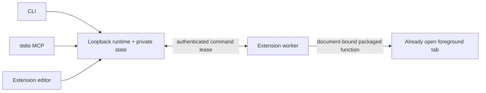

# Architecture and decisions

Two installations: unpacked Chromium Browser Adapter, and a Node Agent Connector containing the runtime, CLI, stdio MCP server and usage skill. One explicitly started runtime owns browser binding, observations, operations, drafts, tests, installed revisions and activation. CLI/MCP/popup call that same runtime; no per-client pack stores.

## Transport choice

Authenticated loopback HTTP is chosen for this first local version. It avoids per-browser native-host registry/manifest installation and works with an unpacked extension. Native Messaging would provide a browser-enforced extension allowlist and no TCP listener, but adds host-registration and process ownership complexity. This choice is reversible. No remote gateway is provided.

The server binds only 127.0.0.1. Host must match the configured literal address/port. Browser requests must have the configured chrome-extension Origin and identity header, plus an unguessable bearer token; website Origins, null Origins and preflights from other sites are rejected. Local CLI requests have no Origin and need the same token. No cookie authentication, wildcard CORS, external extension messaging, URL tokens or page bridge. Browser identity headers are not an OS-local security boundary: local code with the secret can impersonate the client. Protect the private data directory with OS permissions. Pairing values are kept in a private file and extension local storage, never emitted by status or examples.

An explicit popup bind chooses one tab. Rebinding or reconnect changes the runtime session and invalidates observations. Worker restart requires a new bind. Commands receive one lease; timeouts become unknown, never automatically redelivered. Operation IDs persist before delivery. Restart preserves receipts but invalidates browser evidence; pending receipts become unknown. Same-surface work is serialized. An unresolved action fences further input until explicit browser rebind.

## Observation and action

The isolated-world collector visits bounded light DOM, returns current-viewport text and controls, rectangles, semantic labels, states and parent relations. Hit testing proves DOM routing at one point, not pixel visibility or text legibility. Frames, closed shadow DOM, canvas and unsupported paint remain unknown. Native password and sensitive form values are omitted. The adapter verifies active foreground tab/window and Chrome documentId around observation.

Actions are limited to synthetic native-field fill, DOM click on ordinary same-tab HTTP(S) links, and bounded element scroll. This is not trusted OS input. Every action carries the original observation, document, revision, user-input epoch, URL, viewport and target signature. A synchronous guard immediately precedes dispatch. DOM mutations, scroll/resize, navigation, trusted page input and stale age invalidate evidence. No automatic click on submit/delete/purchase controls; packs cannot elevate primitive permissions. Fill requires exact expected value and supports ordinary text/search fields only. Results separate accepted, not-sent/synthetic-dispatched/unknown, and observed/not-observed/unknown outcome. Neither ACK nor subsequent observation proves causation.

## Packs and evidence

Strict versioned JSON packages describe origin/global and path/condition scopes, semantic roles with bounded selectors, extraction, permissions, procedures and pre/postconditions. Definitions contain no scripts or captures. Global definitions may read; action procedures require a specific origin. Selectors locate only currently observed nodes and ambiguous matches are withheld. Multiple matching packs remain separate and conflicting role IDs are reported, never silently ranked.

Drafts are immutable content-addressed revisions. Locator tests acquire a NEW observation after draft creation and bind results to exact revision/session. A test needs a useful matched role and satisfied scope; unresolved/future roles and procedure outcomes remain unverified. Activation is explicit. Reuse rechecks the page; past tests are not ongoing authorization. Installed bases and overlays stay separate. Overlay base hashes are pinned; references validate against composed roles; origin/path/permissions cannot widen. Preview reports field conflicts without automatic merge. Export emits only definitions; inspect selectors/labels/static text for private information.

Procedures accept at most 16 named strings of at most 4,000 characters, substituted as complete fill values without interpolation/eval. The durable intent binds arguments and pinned active/effective revision hashes. Initial preconditions run once; continuing scope and the current step target are checked per step; final postconditions run last. Unrelated/future roles need not be visible initially. After-lease cancellation returns possible-delivery unknown, fences input and stops later steps; it cannot interrupt already executing browser code. Worker snapshots session/binding and checks them after awaits.

Text acquisition never reads whole container innerText. A bounded light-DOM text pass assigns text to the nearest selected owner, tests per-codepoint Range rectangles fully within the viewport and ancestor overflow clips, and omits hidden/sensitive/unsupported effects. Metadata labels remain separate. Budgets/omissions are explicit; text without complete local evidence cannot satisfy a text condition. This is geometric DOM sampling, not pixel reading or visual-occlusion verification.

State writes recheck the original disk digest after the temporary file has been written/synced and immediately before rename. This narrows but does not eliminate concurrent external-edit races: digest-check + rename is not atomic CAS. One runtime owns the directory; external editing is unsupported. Conflict leaves current in-memory definitions and the editor draft available for recovery. The persisted ledger stops at 10,000 records for parents and primitives; no unsafe receipt eviction/replay is hidden in pruning.

## External references

Chrome supports document-targeted packaged functions with activeTab/scripting ([official scripting API](https://developer.chrome.com/docs/extensions/reference/api/scripting)). MCP uses newline-separated JSON-RPC on stdio ([official transport specification](https://modelcontextprotocol.io/specification/2025-06-18/basic/transports)). Supported protocol versions are explicit in the connector; client interoperability requires actual testing.
